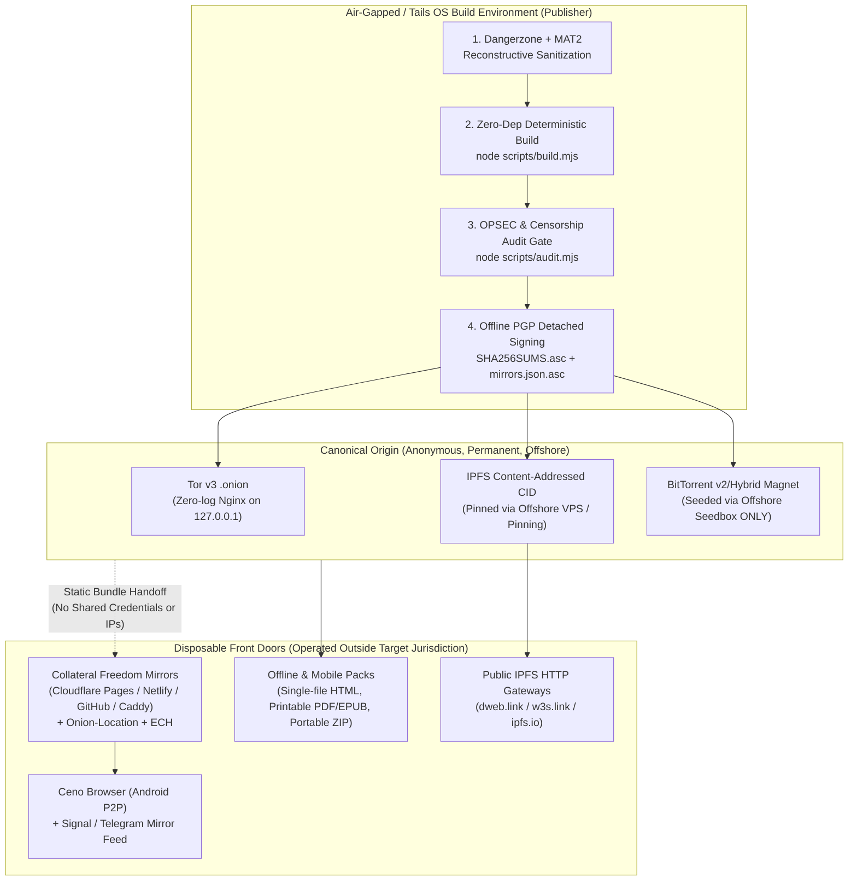

# Censor-Proof Public-Interest Archive Template

> [!CAUTION]
> **Read This Before Publishing Anything Real**
>
> 1. **No website is 100% unblockable or untraceable.** Real-world compromises rarely happen because cryptography broke — they happen via payment trails, unstripped document metadata, canary traps, IPFS/BitTorrent IP leaks, git metadata, or human error.
> 2. **A green build & audit proves integrity of the output bytes, NOT source safety or factual accuracy.** Automated checks cannot guarantee that an internal document lacks canary traps, printer tracking dots, or writing-style fingerprints.
> 3. **Never put real evidence, unredacted files, or source identities into cloud AI / LLMs.** Use AI strictly to build and audit this public template code (see [ADR-009](docs/adr/ADR-009-ai-data-boundary.md)).
> 4. **If you are an individual inside Thailand holding raw evidence:** Your safest option is almost always **not** to run a website yourself, but to submit via **Tails OS + Tor** to an established investigative newsroom using **SecureDrop** or **GlobaLeaks**.

---

## What This Repository Is

This repository is an **end-to-end AI SDLC reference architecture and working starter template** for publishing a **censorship-resistant, verifiable, offline-capable public-interest / anti-corruption archive** (bilingual **English + Thai** ready out of the box).

It is designed both as:
1. **A practical, zero-dependency working template** you can build, audit, package, sign, and deploy immediately (`npm run build && npm test`).
2. **A deep architecture study guide** covering every censorship angle (DNS poisoning, TLS SNI/DPI blocks, court-ordered ISP blocks, SLAPP/defamation takedowns, DDoS, mirror tampering, reader surveillance, and publisher OPSEC).

### Core Architectural Principle: Separate Canonical Origin from Burnable Front Doors



---

## Quick Start (Try It Locally in 30 Seconds)

Requires only **Node.js >= 20** (zero `npm install` packages — zero supply-chain bloat).

```bash
# 1. Build the static site, single-file offline bundle, printable bundle, portable ZIP, and SHA-256 manifest
npm run build

# 2. Run the full OPSEC, censorship-resistance, reproducibility, and sanitization audit suite
npm test

# 3. Preview locally (loopback-only zero-log dev server on 127.0.0.1:4173)
npm run preview
```

Outputs generated into `dist/`:
- `dist/site/` — 100% static, zero-JS, strictly relative-path website (works on `.onion`, `/ipfs/<CID>/`, `file://`, and any clearnet subpath).
- `dist/offline/archive-offline.html` — self-contained single-file HTML archive (shareable via Signal/Telegram/USB).
- `dist/offline/archive-printable.html` — print-to-PDF ready edition (for LINE / iOS users where raw `.html` attachments render poorly).
- `dist/offline/archive-portable.zip` — deterministic ZIP archive (fixed UTC timestamps, sorted entries) for offline browsing and BitTorrent seeding.
- `dist/site/mirrors.json` — machine-readable mirror directory & correction/superseding manifest.
- `dist/manifest.json` & `dist/SHA256SUMS` — deterministic SHA-256 checksums ready for offline PGP signing (`SHA256SUMS.asc`).

---

## AI SDLC Documentation Map

Read these in order for a complete architecture walkthrough:

| Phase | Document | What You Will Learn |
| :--- | :--- | :--- |
| **0. Start Here (ELI5 & Quick Setup)** | [docs/00-eli5-and-activist-quick-guide.md](docs/00-eli5-and-activist-quick-guide.md) | Zero-jargon ELI5 explanation, 3-second decision tree, simple 5-step activist setup, and the 5 golden survival rules. |
| **1. Requirements & Threat Model** | [docs/01-requirements-and-threat-model.md](docs/01-requirements-and-threat-model.md) | Adversary profiles (MDES, Thai ISPs, SLAPP litigants, hosting/CDN providers), Thailand legal context (Penal Code s.326–330, CCA s.14), full censorship attack matrix. |
| **2. Architecture** | [docs/02-architecture.md](docs/02-architecture.md) | System diagrams, trust boundaries, canonical vs. disposable layers, deterministic build pipeline, reader verification UX. |
| **3. Architecture Decision Records** | [docs/adr/README.md](docs/adr/README.md) | 9 ADRs covering every major trade-off (Zero-JS, Zero-Dep Build, Origin/Mirror Decoupling, Key Lifecycle, No Custom Intake, Reconstructive Sanitization, Offline/Mobile + Retractions, AI Data Boundary). |
| **4. Deployment Runbook** | [docs/03-deployment-runbook.md](docs/03-deployment-runbook.md) | Step-by-step setup for Tor v3 `.onion`, hardened zero-log Nginx, v3 Client-Auth SSH, offshore IPFS/BitTorrent publishing, and volunteer clearnet mirrors. |
| **5. OPSEC & Sanitization** | [docs/04-opsec-and-sanitization.md](docs/04-opsec-and-sanitization.md) | Tails/Whonix workflow, Dangerzone + MAT2 pipeline, canary traps, printer MIC dots, stylometry, Monero procurement, git timezone hygiene. |
| **6. Censorship Response Playbook** | [docs/05-censorship-response-playbook.md](docs/05-censorship-response-playbook.md) | Concrete incident runbooks for DNS/SNI blocks, mirror takedowns, gateway blocks, spoofed mirrors, seized `.onion` keys, and factual corrections. |
| **7. AI SDLC Log** | [docs/06-ai-sdlc-log.md](docs/06-ai-sdlc-log.md) | Transparent log of how Gemini and Claude collaborated (architecture critique, implementation, security dual-review, and fixes applied). |
| **8. Local Testing Lab** | [docs/07-local-lab-and-virtualbox-guide.md](docs/07-local-lab-and-virtualbox-guide.md) | One-command Docker lab (Tor v3 `.onion`, offline IPFS Path Gateway, Caddy mirror, GPG) + VirtualBox/Whonix & Surfshark VPN OPSEC guide. |

---

## Repository Structure

```text
censor-proof-site-template/
├── content/                        # Edit ONLY this folder to publish a real archive
│   ├── site.config.json            # Site metadata (EN/TH), PGP fingerprint, warrant canary
│   ├── mirrors.json                # Active canonical + burnable front-door mirrors
│   ├── cases/                      # Public-interest case dossiers (Markdown + frontmatter)
│   └── evidence/                   # Sanitized evidence artifacts + mandatory attestation
│       └── sanitized-manifest.json # Required Dangerzone/MAT2 sanitization & legal-review attestations
├── src/
│   ├── styles/main.css             # Zero-external-resource, accessible, print-friendly CSS
│   └── templates/                  # Pure HTML5 templates (zero JS, strict relative paths)
├── scripts/
│   ├── build.mjs                   # Zero-dep deterministic static generator + offline bundler + ZIP
│   ├── audit.mjs                   # Automated OPSEC, censorship-resistance & reproducibility gate
│   ├── verify.mjs                  # Reader/mirror checksum verification tool
│   ├── preview.mjs                 # Loopback-only (127.0.0.1) zero-log preview server
│   └── lib/                        # Pure-JS Markdown parser, ZIP builder, metadata scanner
├── infra/
│   ├── tor/                        # torrc (site + v3 client-auth SSH), hardened nginx, UFW rules
│   ├── ipfs/                       # Offshore CAR export, multi-pinning, DNSLink/ENS notes
│   ├── torrent/                    # Offshore seedbox .torrent + magnet creation script
│   ├── mirrors/                    # Burnable front-door configs (Cloudflare, Netlify, Caddy, Nginx)
│   └── git/                        # Pre-commit OPSEC hook (blocks personal emails & local TZ)
├── docs/                           # Complete AI SDLC documentation & 9 ADRs
└── test/                           # Automated unit & integration tests (node --test)
```

---

## Important Boundaries

- **Do NOT add an upload form or backend to this template.** Accepting tips/leaks requires battle-tested intake software (**GlobaLeaks** or **SecureDrop**) on completely separate infrastructure. See [ADR-006](docs/adr/ADR-006-no-custom-intake-forms.md).
- **Do NOT run clearnet mirrors or BitTorrent/IPFS nodes from inside Thailand** (or from personal/KYC accounts tied to the anonymous publisher).
- **Sample content in `content/cases/` is 100% fictional** (a fabricated municipal procurement audit example) created strictly to demonstrate structure, bilingual rendering, evidence citations, visual fingerprint verification, and correction notices.
