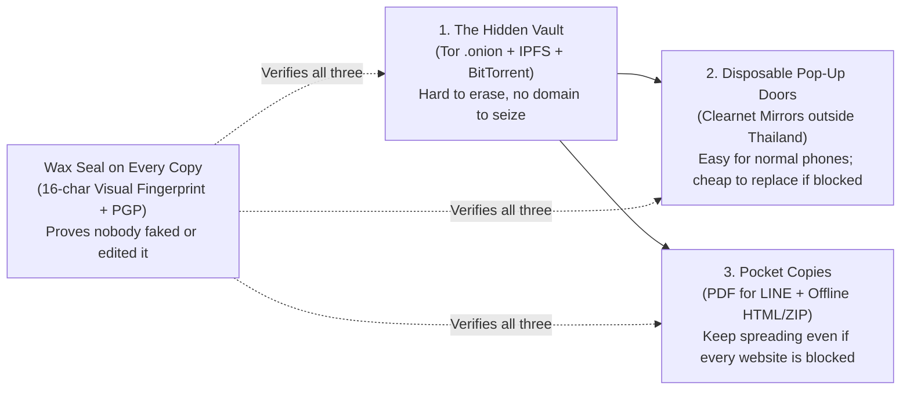

# 00 — ELI5 & Simple Setup Guide (For Regular People & Activists)

> **No technical background required.** If you just want to understand *how* censorship-resistant publishing works and follow a simple, safe checklist without drowning in engineering jargon, start here.

---

## 1. ELI5: Why Normal Websites Get Blocked (And How This Beats It)

Imagine you have a folder of proof about public corruption and you want everyone in Thailand to be able to read it.

If you put it on a **normal website** (`corruption-truth.com` on a normal server):
1. **The Phonebook Block (DNS Poisoning):** Authorities tell Thai internet providers (AIS, True, 3BB, NT) to erase your address from the internet phonebook — or redirect visitors to a government block page.
2. **The Envelope Peek (TLS SNI Blocking):** Even with `https://`, your browser whispers the website's domain name on the outside of the envelope. ISPs read that name and hang up the connection.
3. **The Landlord Takedown (SLAPP / Defamation Law):** Powerful people send legal threats to your domain registrar or hosting company (or find your credit card / phone number on the account!).

### The Solution: One Hidden Vault + Many Disposable Front Doors

Instead of putting everything behind one fragile door, this template splits your archive into **three simple layers**:



1. **The Hidden Vault (Canonical Origin):**
   - **Tor `.onion`:** A website address that needs **no domain registrar** and hides where the server physically lives.
   - **IPFS (`CID`):** Instead of a street address ("go to 123 Main St"), IPFS gives your website a **fingerprint ID** based on its exact contents. Anyone in the world who holds a copy can hand it to regular people through normal web links (`https://<CID>.ipfs.dweb.link/`).
   - **BitTorrent:** Lets volunteers worldwide keep copies alive peer-to-peer.
2. **Disposable Pop-Up Doors (Burnable Mirrors):**
   - Regular people on phones won't install Tor just to click a link. So volunteers **living outside Thailand** host plain copies on huge global platforms (Cloudflare Pages, Netlify, GitHub Pages). If Thai ISPs block Mirror #1 on Monday, volunteers open Mirror #2 in 2 minutes using the exact same files.
3. **Pocket Copies (Offline & LINE-Friendly):**
   - This template automatically builds a **single-file offline webpage**, a **printable PDF version** (for **LINE** and **iPhones**), and a **tiny `.zip`**. Even if every link gets blocked, people keep forwarding the PDF in chat groups.
4. **The Wax Seal (Visual Fingerprint):**
   - Every page shows a short 16-character code at the top (example: `A081-B87B-CE2D-0814`). If a bad actor creates a fake mirror and changes one number or name, **the code will not match**. Even someone on a phone can check it in 2 seconds!

---

## 2. Stop & Pick Your Situation First (3-Second Decision Tree)

| Your Situation | What You Should Do | What You Should NOT Do |
| :--- | :--- | :--- |
| **A. "I have secret proof of corruption right now."** | **Do NOT build a website yourself.** Boot **Tails OS** on a USB stick, open Tor Browser, and send the evidence to an established investigative newsroom's **SecureDrop** or **GlobaLeaks** dropbox. | Don't register hosting, don't upload from your phone/work laptop, don't paste leaked files into ChatGPT/Gemini/Claude, and don't tell friends. |
| **B. "I just want to read & share an archive safely in Thailand."** | Use **Tor Browser**, a trusted **VPN**, or **Ceno Browser** (Android). When sharing in LINE, share the **sanitized PDF** + check the **16-char Visual Fingerprint** matches the official announcement. | Don't open sensitive clearnet links on your office Wi-Fi without VPN/Tor, and don't trust a mirror whose Visual Fingerprint doesn't match. |
| **C. "We are an activist / journalist team publishing a public archive."** | Follow the **Simple 5-Step Setup** below — keeping publishing anonymous/offshore and clearnet mirrors strictly **outside Thailand**. | Never run a clearnet mirror or seed BitTorrent/IPFS from a Thai IP or personal account, and never add a custom "Upload Tip" form to this site. |

---

## 3. Simple 5-Step Setup (For Activist Teams & Non-Programmers)

You only need **Node.js (v20+)** — no complicated frameworks, no `npm install`, no databases.

### Step 1: Clean Every Evidence File First (Most Important Step!)
Real photos, PDFs, and Word/Excel files secretly hide your **name, computer username, GPS location, edit history, and even invisible yellow printer dots**.
1. **PDFs / Word / Excel / PowerPoint:** Run every document through **[Dangerzone](https://dangerzone.rocks/)** (it turns every page into flat pixels and rebuilds a brand-new clean PDF — destroying hidden text behind black redaction boxes!). If scanned from a color printer, make it **grayscale** first.
2. **Photos / Screenshots:** Crop out clocks/icons and scrub with **MAT2** (built into Tails OS).
3. **Rename Files Neutrally:** Rename `Ministry_Budget_Final_Somchai.pdf` → `EVD-001.pdf`.
4. Put the cleaned files in `content/evidence/` and record their SHA-256 hash + cleaning method in `content/evidence/sanitized-manifest.json`. *(Our safety check automatically refuses to build if you forget this step!)*

### Step 2: Edit Just 3 Simple Files in `content/`
1. **`content/site.config.json`** — Put your archive's English & Thai title, release version, UTC date, Warrant Canary, and PGP fingerprint. Set `"isSampleTemplate": false`.
2. **`content/cases/case-001-en.md` & `case-001-th.md`** — Write your factual findings in plain Markdown (short, neutral, verifiable facts + why it matters to the public).
3. **`content/mirrors.json`** — List your `.onion` address, IPFS CID, BitTorrent magnet, and volunteer mirror links.

### Step 3: Build & Run the Automatic Safety Check
Run these two commands (works 100% offline inside Tails OS):

```bash
npm run build
npm run audit:opsec
```

The built-in safety gate automatically checks that:
- Zero trackers, zero Google Fonts, zero JavaScript, and zero external links exist.
- Every link works offline (`file://`), on Tor `.onion`, and on IPFS gateways.
- No raw Office files, EXIF/PDF metadata leaks, or Windows/Mac username paths slipped in.
- Every case has a documented public-interest basis and UTC dates (no `+07:00` timezone leak).
- Building twice produces the **exact same SHA-256 hash** down to the last byte.

> **Honest Reminder:** A green check confirms the website files are clean and tamper-proof — it **cannot** check whether a document has a canary trap (unique wording given only to you) or whether only 3 people at your office had access to it. Always use human judgment first!

### Step 4: Sign & Publish to the Hidden Vault (Offshore Only)
1. **Sign offline** with your Tails PGP key:
   ```bash
   gpg --armor --detach-sign --output dist/site/SHA256SUMS.asc dist/site/SHA256SUMS
   ```
2. Upload `dist/site/` to your **offshore Tor v3 `.onion`** server (funded with Monero, never a Thai bank card).
3. Pin `dist/site/` to **IPFS** and seed `dist/offline/archive-portable.zip` on **BitTorrent** **ONLY from an offshore server/seedbox** — never from home Wi-Fi or a Thai IP.

### Step 5: Let Volunteers Outside Thailand Open the Front Doors & Share
1. Give diaspora volunteers or journalists **outside Thailand** the public signed bundle (`dist/site/` + `SHA256SUMS.asc`).
2. They verify it (`gpg --verify SHA256SUMS.asc SHA256SUMS && node scripts/verify.mjs`) and drag-and-drop `dist/site/` onto **Cloudflare Pages** (turn on **ECH** to beat ISP SNI blocking!) or **Netlify**.
3. Open `dist/offline/archive-printable.html` → Print to PDF → scrub that PDF with `mat2` → share the **PDF + Visual Fingerprint + Mirror list** in Signal/Telegram/LINE!

---

## 4. The 5 Golden Survival Rules (Print This in Your Head)

1. **Never pin IPFS or seed BitTorrent from home or any Thai IP** — both broadcast your IP publicly. (Even a personal VPN is fine for *testing a fictional demo*, NOT for real high-risk whistleblowing.)
2. **Never put real leaked files into cloud AI (ChatGPT, Gemini, Claude)** — use AI only for generic public template code like this repo.
3. **Never let someone living in Thailand host a clearnet mirror** — Thai criminal defamation (s.326–328) and CCA (s.14) put local mirror operators in direct danger.
4. **Never publish a raw PDF or Word file** — always reconstruct through Dangerzone + grayscale + MAT2, and think about narrow suspect pools & canary traps.
5. **Never mix personal life and anonymous ops** — separate Tails USB, UTC timestamps, pseudonymous keys, and tell nobody.

---

## Want to Practice Right Now? (Safe Fictional Demo)

Try the built-in template locally on your own computer in 30 seconds:

```bash
npm run build      # Generates the EN/TH site, offline HTML, printable PDF page, and ZIP
npm test           # Runs all security, metadata, and reproducibility checks
npm run preview    # Opens a private local preview at http://127.0.0.1:4173/
```

When you are ready to go deeper into the engineering details, continue to [01-requirements-and-threat-model.md](01-requirements-and-threat-model.md) and [07-local-lab-and-virtualbox-guide.md](07-local-lab-and-virtualbox-guide.md).
