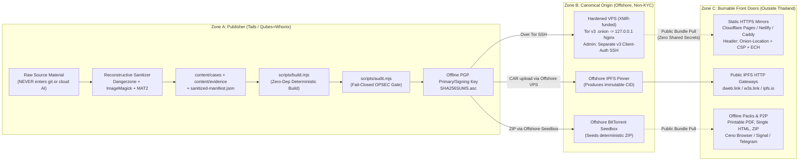
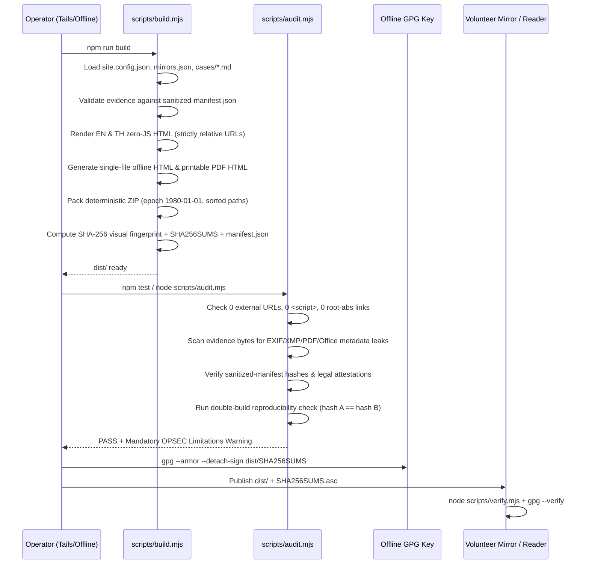

# 02 — System Architecture

## 1. Architectural Overview

The system follows a **Three-Zone Trust Boundary** design:

1. **Zone A — Air-Gapped / Amnesic Production Zone (Publisher):** Tails OS or Qubes+Whonix. Raw documents are reconstructed (Dangerzone/MAT2), compiled deterministically with zero external dependencies, audited by automated OPSEC gates, and cryptographically signed with an offline PGP key. **Never touches clearnet KYC accounts.**
2. **Zone B — Anonymous Canonical Origin (Offshore):** Holds the immutable, authoritative copy across three censorship-resistant transports:
   - **Tor v3 `.onion`** (static zero-log Nginx on `127.0.0.1`, administered exclusively over a separate v3 client-authorized SSH onion).
   - **IPFS** (Content-Addressed CID, pinned strictly from an offshore anonymous node/pinning service — *never* a home or Thai IP).
   - **BitTorrent v2/hybrid** (seeded strictly from an offshore anonymous seedbox — *never* home IP and *never* routed over Tor).
3. **Zone C — Burnable Front Doors (Public Access Layer):** Operated by independent diaspora volunteers, journalists, or international NGOs **outside Thailand**. Because every mirror serves the exact same deterministic static bundle and carries the publisher's PGP signature + visual fingerprint, mirrors are **untrusted by design** — readers can detect tampering, and if a mirror is blocked or taken down, another replaces it in minutes without exposing Zone A or Zone B.



---

## 2. Build, Audit & Verification Pipeline

The build pipeline is intentionally **simple enough for a single security auditor to read completely in 15 minutes** (zero external npm packages, pure Node.js >= 20 standard library).



---

## 3. Portability Design (Why Strictly Relative Paths Matter)

A single build artifact must render identically under **five completely different URL bases**:

| Hosting Channel | Example URL | Why Root-Absolute (`/style.css`) Breaks |
| :--- | :--- | :--- |
| **Tor v3 Onion** | `http://abc...xyz.onion/cases/case-001.html` | Works at root, breaks if mounted at subpath |
| **IPFS Path Gateway** | `https://ipfs.io/ipfs/bafy.../cases/case-001.html` | `/style.css` resolves to `https://ipfs.io/style.css` -> **404!** |
| **GitHub Pages (Project)** | `https://org.github.io/archive/cases/case-001.html` | `/style.css` resolves to `https://org.github.io/style.css` -> **404!** |
| **Local Offline Folder (`file://`)** | `file:///USB/site/cases/case-001.html` | `/style.css` resolves to filesystem root `C:\style.css` -> **Broken!** |
| **Single-File Offline HTML** | `archive-offline.html` (inlined CSS + anchor links) | Cannot load external files at all — must inline CSS & data |

Therefore:
- Pages at root (`index.html`, `th/index.html` -> `../assets/main.css`) compute exact relative prefixes (`./`, `../`, `../../`) for every stylesheet, link, and evidence file.
- Every internal link points explicitly to `index.html` (e.g., `./th/index.html`, `../index.html`) rather than relying on web-server directory-index magic — ensuring **100% compatibility with `file://` double-click browsing** on Windows, macOS, Android, and Linux!

---

## 4. Security Posture & HTTP Headers

Every server template in `infra/` enforces the same hardened posture:

```http
Content-Security-Policy: default-src 'none'; style-src 'self' 'unsafe-inline'; img-src 'self' data:; font-src 'self'; base-uri 'none'; form-action 'none'; frame-ancestors 'none'; object-src 'none'
Referrer-Policy: no-referrer
X-Content-Type-Options: nosniff
X-Frame-Options: DENY
Permissions-Policy: accelerometer=(), camera=(), geolocation=(), gyroscope=(), magnetometer=(), microphone=(), payment=(), usb=(), interest-cohort=()
Cross-Origin-Opener-Policy: same-origin
Cross-Origin-Resource-Policy: same-origin
```

On clearnet mirrors **only** (never on `.onion` itself):
```http
Onion-Location: http://<your-v3-address>.onion$request_uri
Strict-Transport-Security: max-age=63072000; includeSubDomains
```

---

## 5. Reader Verification UX (Technical & Non-Technical)

Because ordinary readers on mobile phones will rarely run `gpg --verify`, verification is layered into **two tiers**:

1. **Tier 1 — Visual Fingerprint (For Everyone / LINE / Mobile):**
   Every page header, offline HTML file, and printable PDF displays the **Release Version, UTC Build Date, and Short Visual Fingerprint** (e.g., `FP: 9F3A-4C12-88B0-1E7D`, derived deterministically from the sorted content hashes). When the archive is announced on Signal/Telegram/newsrooms, that 16-character code is posted alongside the mirror URL so anyone can eyeball-check that a mirror hasn't been tampered with.
2. **Tier 2 — Full Cryptographic Verification (For Journalists & Mirror Operators):**
   `SHA256SUMS` + `SHA256SUMS.asc` (PGP detached signature) + `scripts/verify.mjs` verify every single byte of the site and evidence files against the publisher's pinned PGP fingerprint.

---

## 6. Key Architecture Decisions

Detailed rationale, trade-offs, and rejected alternatives are documented in [docs/adr/README.md](adr/README.md).
